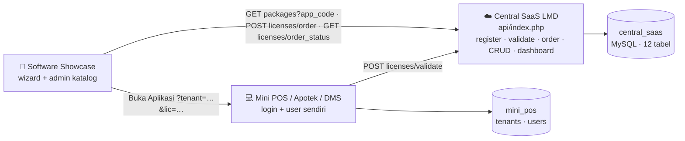
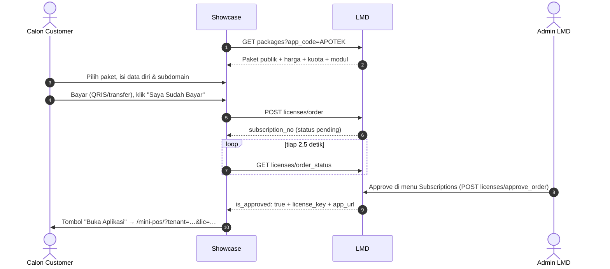
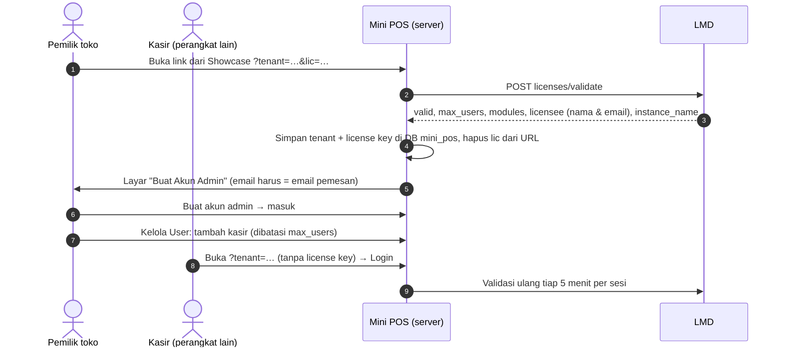
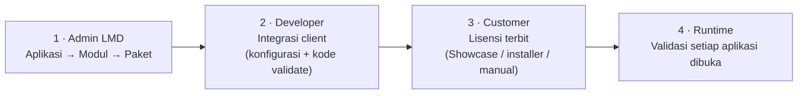
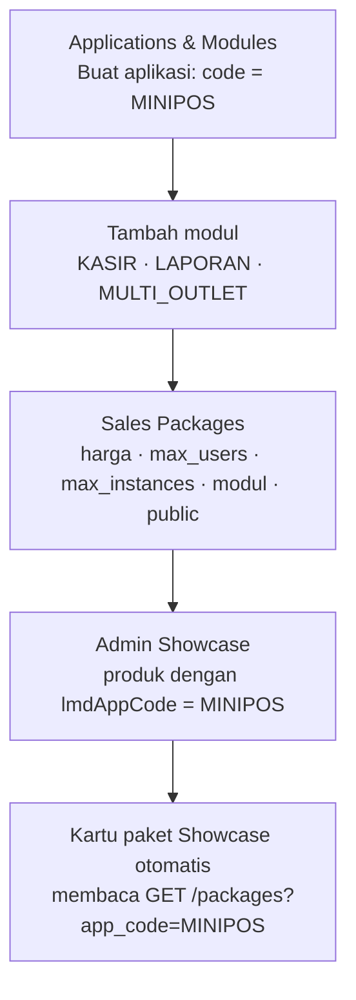
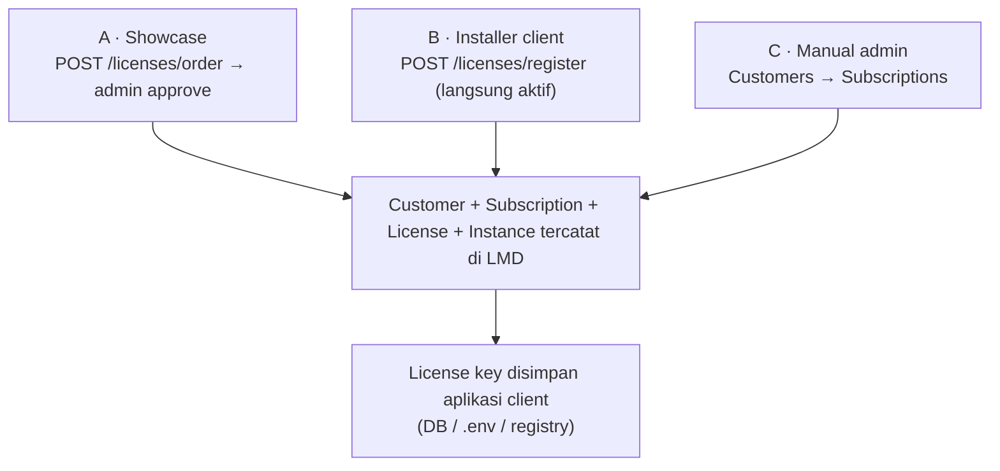
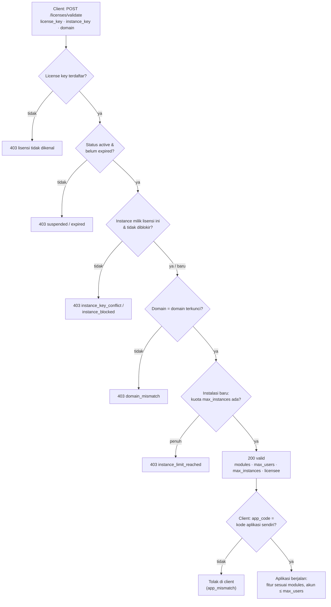

# Ekosistem Central SaaS LMD — Cara Kerja Sistem

> Dokumen ini disusun dari pembacaan **kode** (bukan hanya docs) pada branch pengembangan per 2026-10-23.
> Versi visual: menu **Buku Panduan → tab 🧭 Ekosistem Central SaaS** di dashboard LMD (wajib disinkronkan dengan dokumen ini), dan https://claude.ai/artifact/1MFMqHEvSLC6c3UHLEkZHi (privat).
> Status implementasi terkini dan riwayat temuan ada di [`LOG_EVALUASI.md`](LOG_EVALUASI.md).

Tiga aplikasi, satu database:

| Sistem | Repo | Peran |
|---|---|---|
| **Central SaaS LMD** | `joan-hidayat/lmd` | Menentukan siapa boleh memakai fitur apa (daftar `modules` + `max_users`), menerbitkan & memvalidasi lisensi, dashboard analitik. |
| **Software Showcase** | `joan-hidayat/software-showcase` | Etalase produk, wizard berlangganan 4 langkah, admin katalog (`/admin`). |
| **Aplikasi Client** | `joan-hidayat/sample-mini-pos` (contoh) | Operasional bisnis (kasir, user, role sendiri). Bertanya ke LMD sebelum membuka fitur. |

---

## 1. Peta Sistem



Semua komunikasi antar-sistem lewat HTTP JSON ke `LMD/api/index.php`. Setiap aplikasi punya database sendiri: LMD memakai `central_saas`, Mini POS memakai `mini_pos` (akun user & salinan lisensi). Mini POS tidak lagi membaca database LMD secara langsung.

---

## 2. Model Data — Empat Lapisan

| Lapisan | Pertanyaan | Tabel | Contoh |
|---|---|---|---|
| **Katalog** | Apa yang dijual? | `applications`, `modules`, `packages`, `package_modules` | APOTEK → APO_BASIC: DASHBOARD, INVENTORY, MASTER_OBAT, POS_KASIR, maks 3 user |
| **Komersial** | Siapa membeli apa? | `customers`, `subscriptions`, `subscription_modules` | Apotek Maju Jaya, SUB-2026-xxxxx, 1 tahun, harga dikunci saat beli |
| **Provisioning** | Kunci apa yang diterbitkan? | `licenses`, `license_modules`, `application_instances`, `license_activations` | LIC-APOTEK-BE59… terikat ke INST-APO-MJJ-001 |
| **Runtime** | Apa yang terjadi saat dipakai? | `license_logs`, `last_seen_at` | Sumber grafik API Health & Instance Heartbeat |

Prinsip penting: modul **disalin turun** `package_modules` → `subscription_modules` → `license_modules`. Lisensi yang sudah terbit tidak berubah walau isi paket diedit kemudian.

**Pengecualian — `future_module_access` (T-13):** jika paket bertanda *fitur baru otomatis*, modul yang **dibuat setelah** paket/subscription itu otomatis ditambahkan ke `package_modules`, `subscription_modules` (`source = 'future_module'`), dan `license_modules`, lalu dicatat di `license_logs` (`future_module_granted`). Modul yang sudah ada saat paket dibuat tidak ditambahkan, sehingga isi paket pilihan admin tetap utuh. Modul yang dihapus (`deleted_at`) tidak lagi dikirim di `validate`.

**Tiga kunci:**
- `license_key` — bukti hak pakai.
- `instance_key` — identitas satu instalasi (satu server/toko).
- `activation_key` — catatan aktivasi pertama instance tersebut.

**Bukan urusan LMD:** user, role, permission di dalam aplikasi client. LMD hanya mengirim `modules` dan `max_users`; aplikasi client yang wajib menegakkannya.

---

## 3. Alur A — Auto-Register dari Installer Client

Dipakai saat aplikasi client di-install (desktop, on-premise, atau portal cloud).

```http
POST /api/licenses/register
{ "app_code":"APOTEK", "package_code":"APO_BASIC",
  "customer_name":"Apotek Maju Jaya", "customer_email":"owner@apotekmajujaya.com",
  "instance_key":"INST-APO-MJJ-001", "domain":"apotekmajujaya.com" }
```

Dieksekusi dalam **satu transaksi** (`LicenseModel::registerAutoLicense`); satu langkah gagal = semua di-rollback:

1. Cari aplikasi & paket berdasarkan kode (tidak ketemu → batal).
2. Cari customer berdasarkan email; belum ada → buat `CUST-xxxxxx`.
3. Buat subscription 1 tahun, salin `max_users`, `max_instances`, harga, billing cycle dari paket.
4. Salin modul paket ke `subscription_modules`.
5. Terbitkan `license_key` acak (`random_bytes`), salin modul ke `license_modules`.
6. Daftarkan instance (instance_key + domain).
7. Buat activation (`activation_key`).
8. Response: `license_key`, `activation_key`, `max_users`, `modules`. Client menyimpannya di `.env`/DB lokal.

Dashboard ikut berubah karena grafik dihitung dari tabel yang sama setiap halaman dimuat.

---

## 4. Alur B — Berlangganan via Showcase (Self-Service)



Beda dengan Alur A: subscription dibuat **pending** dan baru aktif setelah admin menyetujui pembayaran. Masa aktif dihitung **sejak tanggal approve**, bukan tanggal pesan.

**Endpoint (`LicenseController` + `OrderModel`)**

| Endpoint | Fungsi | Respons penting |
|---|---|---|
| `GET /packages?app_code=APOTEK` | Katalog paket publik (status `active`, `is_public = 1`) beserta modul | `code`, `name`, `base_price`, `billing_cycle`, `max_users`, `modules[]` |
| `POST /licenses/order` | Buat pesanan: customer (dicari via email), subscription `pending`, modul, lisensi `suspended`, instance `{subdomain}.pos.local` | `201` + `subscription_no`, `total_price` (PPN 11%), `instance_domain` |
| `GET /licenses/order_status?subscription_no=` | Polling Showcase | `is_approved`, `is_rejected`; `license_key` & `app_url` hanya setelah approve |
| `POST /licenses/approve_order` | Admin/n8n menyetujui pembayaran: subscription & lisensi `active`, instance aktif, activation dibuat | `200` + `license_key`, `expires_at`, `app_url` |
| `POST /licenses/reject_order` | Menolak: subscription `cancelled`, lisensi `revoked` (subdomain bisa dipakai lagi) | `200` + `is_rejected: true` |
| `GET /licenses/pending_orders` | Daftar pesanan `pending` untuk otomasi (n8n) | `subscription_no`, customer, paket, `instance_domain`, `total_price` |
| `GET /licenses/{id}/instances` | Instance yang terhubung ke satu lisensi (dipakai modal **Licenses → Detail**) | `max_users`, `max_instances`, `instances[]` |
| `POST /instances/{id}/status` | Admin memblokir / mengaktifkan instalasi (`{"status":"blocked"\|"active"}`) | `200`; `409` jika kuota penuh saat mengaktifkan |

Kode error: `400` input tidak valid (email, format subdomain), `404` paket/pesanan tidak ada, `409` subdomain sudah dipakai atau pesanan sudah diproses.

**Catatan desain**
- Selama pending, lisensi berstatus `suspended` karena enum `licenses.status` tidak punya `pending` (dipilih agar schema DB yang sudah terpasang tidak perlu migrasi). Status pesanan dibaca dari `subscriptions.status`. Validate menolak lisensi ini sampai di-approve.
- `instance_key` mengikuti konvensi Mini POS: `INST-STORE-{8 karakter terakhir license key}`.
- Wizard Showcase tidak lagi meminta password. Akun admin dibuat di aplikasi client saat pertama dibuka (lihat Alur C).
- Admin melihat pesanan di **Dashboard** (banner) dan **Subscriptions → Persetujuan Pembayaran & Aktivasi Domain Klien** (tombol Approve / Tolak). Endpoint `approve_order` yang sama siap dipanggil n8n.

---

## 5. Alur C — Aktivasi, Login, dan Validasi di Aplikasi Client (Mini POS)



| Komponen Mini POS | Peran |
|---|---|
| `lib/LicenseGate.php` | Aktivasi tenant, validasi ke LMD (server-ke-server), cache 5 menit di sesi, mode tenggang 24 jam jika LMD tidak terjangkau. Lisensi tidak valid → redirect ke Showcase. |
| `lib/UserRepository.php` | Akun per tenant (bcrypt), peran Admin/Kasir, kuota user aktif ≤ `max_users`, kunci 5 menit setelah 5 kali login gagal. |
| `setup.php` | Buat akun admin pertama (sekali, hanya jika tenant belum punya user). |
| `login.php` / `logout.php` | Masuk/keluar; token CSRF di semua form; sesi terikat ke satu tenant. |
| `users.php` | Khusus admin: tambah user, nonaktifkan/aktifkan, ganti password. |
| `config.php` | Koneksi DB `mini_pos`, URL LMD, TTL cache, masa tenggang. Override lokal lewat `config.local.php` (di-ignore git). |

**Penegakan kuota (`max_users`):** metode *named users*. Jumlah akun **aktif** tidak boleh melebihi kuota. Jika kuota turun (downgrade), hanya admin yang bisa masuk sampai jumlah user aktif dirapikan. Metode *concurrent sessions* belum dipakai.

Urutan pemeriksaan di `LicenseModel::validateLicense`:

| # | Pemeriksaan | Jika gagal |
|---|---|---|
| 1 | License key ada? | 403, dicatat gagal di `license_logs` |
| 2 | Status lisensi = `active`? | 403 "License status is …" |
| 3 | Belum lewat `expires_at`? | Status diubah ke `expired`, 403 |
| 4a | Instance key milik lisensi lain? | 403 `instance_key_conflict` |
| 4b | Instance terdaftar tetapi diblokir admin? | 403 `instance_blocked` |
| 4c | Instance terdaftar, domain berbeda dari domain terkunci? | 403 `domain_mismatch` (domain diisi sekali saat pertama terikat, tidak pernah ditimpa) |
| 4d | Instance baru, kuota `max_instances` sudah penuh? | 403 `instance_limit_reached` (instance berstatus `blocked` tidak dihitung) |
| 5 | Lolos | 200: `valid`, `modules`, `max_users`, `expires_at`, `licensee` (nama & email pemesan), `instance_name`; dicatat sukses |

> **Kuota instalasi (T-02):** setiap paket punya `max_instances` (seed: Basic 1, Professional 2, Enterprise 5) yang disalin ke subscription. Admin dapat memblokir / mengaktifkan instalasi di **Licenses → Detail** (`POST /instances/{id}/status`); mengaktifkan kembali tetap tunduk pada kuota. Instalasi lama yang melebihi kuota tidak diblokir otomatis.
>
> **Batasan:** `instance_key` dan `domain` dikirim oleh aplikasi client sendiri, sehingga masih bisa dipalsukan oleh pihak yang memegang license key. Penguncian penuh membutuhkan request bertanda tangan (T-04 / T-22).

---

## 5b. Mendaftarkan Aplikasi Client Baru ke LMD

> Kontrak resminya: **[`STANDAR_INTEGRASI.md`](STANDAR_INTEGRASI.md)** (v1). Bagian ini adalah ringkasan visualnya.

LMD **tidak membaca file** di dalam aplikasi client. LMD mengenali aplikasi dari **license key** yang dikirim client saat memanggil `validate`: license key sudah membawa customer, aplikasi (`app_code`), paket, dan modul; `instance_key` + `domain` menunjukkan lokasi instalasinya.

### Empat tahap



### Tahap 1 — Setup di LMD dan Showcase



> ✅ Mini POS terdaftar sebagai `MINIPOS` (3 paket: Starter, Pro, Bisnis) dan produk Showcase-nya memakai `lmdAppCode: "MINIPOS"`. Apotek memakai `APOTEK` tanpa `launch_url` (on-premise). Produk tanpa `lmdAppCode` tampil "Segera hadir".

### Tahap 2 — Yang wajib dimiliki aplikasi client

| # | Kebutuhan | Contoh di Mini POS |
|---|---|---|
| 1 | Identitas & koneksi: `app_code` + URL API LMD | `lmd-client.php` |
| 2 | Penyimpanan license key setelah aktivasi | Database `mini_pos`, tabel `tenants` |
| 3 | Kode pemanggil `POST /licenses/validate` dari server, mematuhi hasilnya | `lib/LicenseGate.php` |

✅ Standar: satu file `lmd-client.php` di setiap aplikasi client:

```php
<?php
return [
    'app_code'            => 'MINIPOS',
    'lmd_api_url'         => 'https://license.domainanda.com/api',
    'instance_key_prefix' => 'INST-STORE-',
    // Production (T-04 / T-22): App ID + secret diterbitkan LMD per aplikasi
    // 'app_id'     => 'app_7f3c...',
    // 'app_secret' => getenv('LMD_APP_SECRET'),
];
```

### Tahap 3 — Tiga jalur penerbitan lisensi



### Tahap 4 — Keputusan saat validasi



Versi visual: https://claude.ai/artifact/EAKYuDsC3ZJrsev4NSFqsk (privat).

---

## 6. Ringkasan Status Implementasi (diperbarui 2026-10-23)

| Bagian | Status | Keterangan |
|---|---|---|
| CRUD katalog, customer, subscription | ✅ Jalan | PDO prepared statements |
| Auto-register (Alur A) | ✅ Jalan | Satu transaksi atomik |
| Validasi + log | ✅ Jalan | ada / status / expired, tulis `license_logs` |
| Dashboard 8 grafik + Radar Aksi | ✅ Jalan | Dihitung saat halaman dimuat |
| Wizard Showcase (UI) | ✅ Jalan | 4 langkah + polling |
| `order`, `order_status`, `approve_order`, `reject_order` | ✅ Jalan | Alur B end-to-end teruji (T-01) |
| Panel persetujuan pembayaran di dashboard | ✅ Jalan | Banner Dashboard + tabel di Subscriptions |
| Detail instance per lisensi | ✅ Jalan | Menu Licenses → Detail (diporting dari WIP lokal) |
| URL API tanpa `index.php` | ✅ Jalan | `api/.htaccess` (butuh `mod_rewrite`, default XAMPP) (T-15) |
| Standar Integrasi v1 (`app_code` di LMD, Showcase, client) | ✅ Jalan | `STANDAR_INTEGRASI.md`; Mini POS = `MINIPOS`, `launch_url` per aplikasi (T-18, T-24) |
| Penguncian instance + domain | ✅ Jalan | Kuota `max_instances` per paket, domain terkunci, blokir oleh admin (T-02). Belum anti-pemalsuan (T-22) |
| Login & manajemen user di Mini POS | ✅ Jalan | Setup admin, login, Kelola User (T-17) |
| Penegakan `max_users` | ✅ Jalan | Mini POS: jumlah user aktif ≤ kuota (T-03) |
| `future_module_access` (modul baru otomatis) | ✅ Jalan | Modul yang dibuat setelah paket/subscription masuk ke paket, subscription (`source = future_module`), dan lisensi; disusulkan juga oleh `migrate.php` (T-13) |
| Paket & harga Showcase sinkron dengan LMD | ✅ Jalan | Showcase membaca `GET /packages?app_code` (T-12) |
| API key / auth admin / rate limit | 📋 Rencana | Hardening sebelum production |
| Password & credential di `.env` | 📋 Rencana | Sengaja hardcode selama pengembangan |
| n8n + payment gateway | 📋 Rencana | Endpoint `approve_order` sudah siap dipanggil |

**Urutan kerja yang disarankan:** (1) pemulihan password admin Mini POS (T-21) → (2) hardening keamanan sebelum production sebagai satu paket: login admin LMD & API key (T-04), rate limit (T-05), request bertanda tangan (T-22), password Showcase (T-07) → (3) rapikan docs lokal (T-09).
