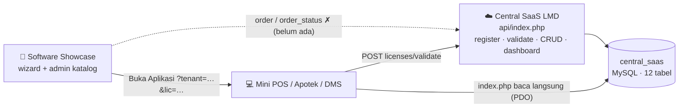
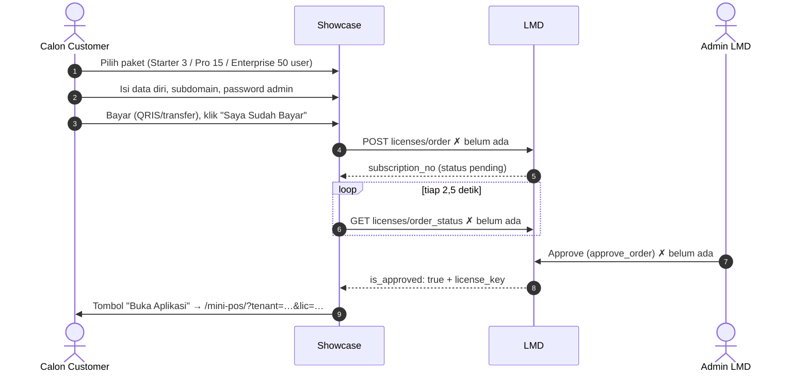

# Ekosistem Central SaaS LMD — Cara Kerja Sistem

> Dokumen ini disusun dari pembacaan **kode** (bukan hanya docs) pada branch pengembangan per 2026-10-23.
> Versi visual: menu **Buku Panduan → tab 🧭 Ekosistem Central SaaS** di dashboard LMD (wajib disinkronkan dengan dokumen ini), dan https://claude.ai/artifact/1MFMqHEvSLC6c3UHLEkZHi (privat).
> Status implementasi terkini dan riwayat temuan ada di [`LOG_EVALUASI.md`](LOG_EVALUASI.md).

Tiga aplikasi, satu database:

| Sistem | Repo | Peran |
|---|---|---|
| **Central SaaS LMD** | `joan-hidayat/lmd` | Menentukan siapa boleh memakai fitur apa (daftar `modules` + `max_users`), menerbitkan & memvalidasi lisensi, dashboard analitik. |
| **Software Showcase** | `joan-hidayat/software-showcase` | Etalase produk, wizard berlangganan 4 langkah, admin katalog (`/admin`). |
| **Aplikasi Client** | `joan-hidayat/sample-mini-pos` (contoh) | Operasional bisnis (kasir, user, role sendiri). Bertanya ke LMD sebelum membuka fitur. |

---

## 1. Peta Sistem



Semua komunikasi lewat HTTP JSON ke `LMD/api/index.php`, **kecuali** `mini-pos/index.php` yang membaca database `central_saas` langsung (karena saat ini semuanya berjalan di satu XAMPP).

---

## 2. Model Data — Empat Lapisan

| Lapisan | Pertanyaan | Tabel | Contoh |
|---|---|---|---|
| **Katalog** | Apa yang dijual? | `applications`, `modules`, `packages`, `package_modules` | APOTEK → APO_BASIC: DASHBOARD, INVENTORY, MASTER_OBAT, POS_KASIR, maks 3 user |
| **Komersial** | Siapa membeli apa? | `customers`, `subscriptions`, `subscription_modules` | Apotek Maju Jaya, SUB-2026-xxxxx, 1 tahun, harga dikunci saat beli |
| **Provisioning** | Kunci apa yang diterbitkan? | `licenses`, `license_modules`, `application_instances`, `license_activations` | LIC-APOTEK-BE59… terikat ke INST-APO-MJJ-001 |
| **Runtime** | Apa yang terjadi saat dipakai? | `license_logs`, `last_seen_at` | Sumber grafik API Health & Instance Heartbeat |

Prinsip penting: modul **disalin turun** `package_modules` → `subscription_modules` → `license_modules`. Lisensi yang sudah terbit tidak berubah walau isi paket diedit kemudian.

**Tiga kunci:**
- `license_key` — bukti hak pakai.
- `instance_key` — identitas satu instalasi (satu server/toko).
- `activation_key` — catatan aktivasi pertama instance tersebut.

**Bukan urusan LMD:** user, role, permission di dalam aplikasi client. LMD hanya mengirim `modules` dan `max_users`; aplikasi client yang wajib menegakkannya.

---

## 3. Alur A — Auto-Register dari Installer Client

Dipakai saat aplikasi client di-install (desktop, on-premise, atau portal cloud).

```http
POST /api/licenses/register
{ "app_code":"APOTEK", "package_code":"APO_BASIC",
  "customer_name":"Apotek Maju Jaya", "customer_email":"owner@apotekmajujaya.com",
  "instance_key":"INST-APO-MJJ-001", "domain":"apotekmajujaya.com" }
```

Dieksekusi dalam **satu transaksi** (`LicenseModel::registerAutoLicense`); satu langkah gagal = semua di-rollback:

1. Cari aplikasi & paket berdasarkan kode (tidak ketemu → batal).
2. Cari customer berdasarkan email; belum ada → buat `CUST-xxxxxx`.
3. Buat subscription 1 tahun, salin `max_users`, harga, billing cycle dari paket.
4. Salin modul paket ke `subscription_modules`.
5. Terbitkan `license_key` acak (`random_bytes`), salin modul ke `license_modules`.
6. Daftarkan instance (instance_key + domain).
7. Buat activation (`activation_key`).
8. Response: `license_key`, `activation_key`, `max_users`, `modules`. Client menyimpannya di `.env`/DB lokal.

Dashboard ikut berubah karena grafik dihitung dari tabel yang sama setiap halaman dimuat.

---

## 4. Alur B — Berlangganan via Showcase (Self-Service)



Beda dengan Alur A: subscription dibuat **pending** dan baru aktif setelah admin menyetujui pembayaran. Ke depan, approve bisa diotomatisasi lewat n8n + payment gateway.

**Status:** UI wizard di Showcase lengkap (`assets/js/app.js`), tetapi router LMD hanya mengenal `licenses/register` dan `licenses/validate`. Wizard berhenti di langkah bayar.

---

## 5. Alur C — Validasi Saat Aplikasi Dibuka

Mini POS mengecek lisensi dua kali:

| Lokasi | Perilaku |
|---|---|
| `mini-pos/index.php` | Tanpa `?tenant` & `?lic` → redirect ke Showcase. Jika ada → query langsung ke `central_saas`: lisensi harus ada dan status lisensi + subscription harus `active`. |
| `mini-pos/app.js` | Simpan data lisensi di `localStorage` (`minipos_license_data`), panggil `POST licenses/validate`. Tidak valid → alert + redirect ke Showcase. Tombol heartbeat memakai endpoint yang sama. |

Urutan pemeriksaan di `LicenseModel::validateLicense`:

| # | Pemeriksaan | Jika gagal |
|---|---|---|
| 1 | License key ada? | 403, dicatat gagal di `license_logs` |
| 2 | Status lisensi = `active`? | 403 "License status is …" |
| 3 | Belum lewat `expires_at`? | Status diubah ke `expired`, 403 |
| 4 | Instance key terdaftar? | **Tidak ditolak** — instance baru dibuat otomatis; jika ada, update `last_seen_at` + domain ditimpa |
| 5 | Lolos | 200: `valid`, `modules`, `max_users`, `expires_at`, dicatat sukses |

> Catatan desain: karena langkah 4 tidak pernah menolak, satu license key saat ini bisa dipakai dari instance/domain mana pun. Memudahkan testing; perlu diperketat sebelum production.

---

## 6. Ringkasan Status Implementasi (2026-10-23)

| Bagian | Status | Keterangan |
|---|---|---|
| CRUD katalog, customer, subscription | ✅ Jalan | PDO prepared statements |
| Auto-register (Alur A) | ✅ Jalan | Satu transaksi atomik |
| Validasi + log | ✅ Jalan | ada / status / expired, tulis `license_logs` |
| Dashboard 8 grafik + Radar Aksi | ✅ Jalan | Dihitung saat halaman dimuat |
| Wizard Showcase (UI) | ✅ Jalan | 4 langkah + polling |
| `order`, `order_status`, `approve_order` | ❌ Belum ada | Penghambat utama Alur B |
| Penguncian instance + domain | 🟡 Sebagian | Instance dicatat, tidak pernah ditolak |
| Penegakan `max_users` | 🟡 Sebagian | Dikirim LMD, belum ditegakkan di client |
| API key / auth admin / rate limit | 📋 Rencana | Hardening sebelum production |
| Password & credential di `.env` | 📋 Rencana | Sengaja hardcode selama pengembangan |
| n8n + payment gateway | 📋 Rencana | Bergantung pada `approve_order` |

**Urutan kerja yang disarankan:** (1) endpoint order/approve → (2) aturan penguncian instance/domain → (3) penegakan `max_users` di client → (4) hardening keamanan sebelum production.
