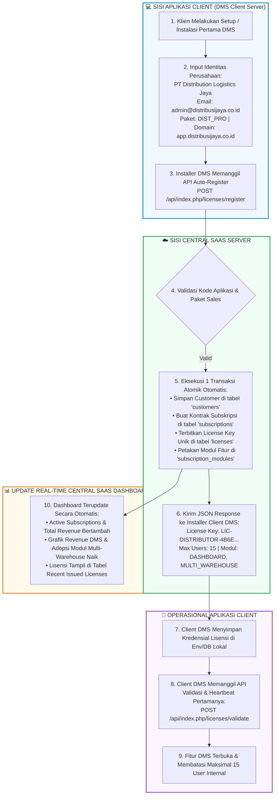
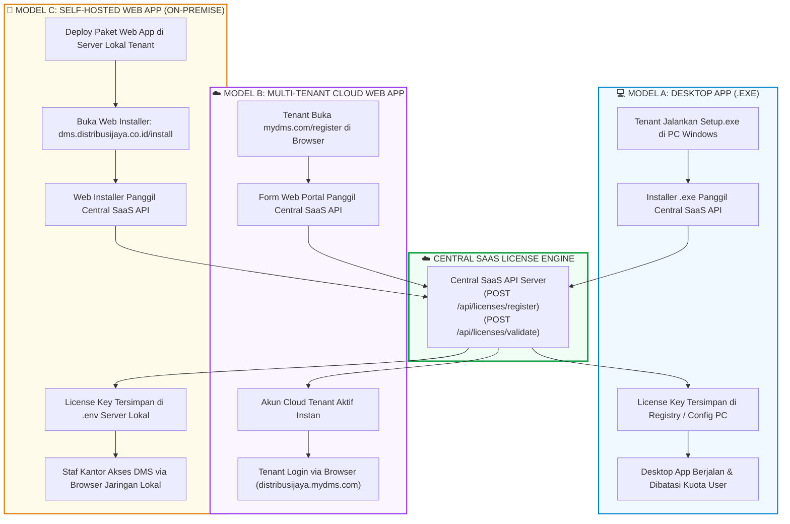

# BUKU PANDUAN PENGGUNAAN
## Central SaaS — License Management Dashboard

---

## 📌 1. Pendahuluan

**Central SaaS License Management Dashboard** adalah platform terpusat untuk mengelola **Katalog Produk (Aplikasi & Modul)**, **Paket Penjualan**, **Data Pelanggan**, **Subskripsi/Kontrak**, serta **Penerbitan & Validasi Lisensi** untuk berbagai aplikasi SaaS (seperti *Apotek System*, *Distributor System*, *Training Management System (TMS)*, *ERP*, dll).

### 💡 Prinsip Utama Arsitektur (Separation of Concerns)
* **Tanggung Jawab Central SaaS**:
  1. Mengelola Katalog Produk (Aplikasi, Modul, & Paket Harga).
  2. Menyediakan API **Auto-Register Customer & Lisensi** secara otomatis.
  3. Menentukan modul fitur apa saja yang **berhak digunakan** oleh pelanggan (`modules`).
  4. Menentukan **batas kuota maksimal pengguna (`max_users`)**.
  5. Memvalidasi status lisensi (aktif, terblokir, kedaluwarsa).
* **Tanggung Jawab Aplikasi Client (Apotek, TMS, Distributor)**:
  1. Memanggil API Auto-Register saat instalasi/pembelian paket oleh customer baru.
  2. Pengelolaan User internal (Admin, Kasir, Apoteker, Sales).
  3. Pengelolaan Role & Permission internal.
  4. *Aplikasi client yang membatasi user mana yang boleh memakai modul tertentu berdasarkan kuota dari Central SaaS.*

---

## 🚀 2. Dua Metode Pendaftaran Customer & Lisensi

1. **Mode 1: Auto-Register (Otomatis / Rekomendasi Utama)**:
   - **Tanpa Input Manual Superadmin**.
   - Saat customer menginstall aplikasi (misal: *Apotek Paket A*), installer aplikasi client otomatis memanggil API `POST /api/licenses/register`.
   - Central SaaS otomatis mendata Customer baru, Subskripsi baru, dan Menerbitkan License Key unik secara gratis dalam 1 transaksi.
2. **Mode 2: Manual Input (Kontrak B2B / Custom)**:
   - Digunakan jika ada penanganan khusus kontrak B2B.
   - Superadmin menambah Customer di menu **Customers**, lalu membuat **Subscription** manual di dashboard.

---

## ⚡ 3. Dokumentasi Integrasi API untuk Aplikasi Client

Aplikasi client (seperti *Apotek*, *TMS*, atau *Distributor*) menggunakan 2 API utama berikut:

### 3.1. API Auto-Register Customer & Lisensi Baru (Instalasi Pertama)
* **URL**: `POST http://localhost:8080/License-Management-Dashboard/api/licenses/register`
* **Headers**: `Content-Type: application/json`
* **JSON Request Body**:
  ```json
  {
    "app_code": "APOTEK",
    "package_code": "APO_BASIC",
    "customer_name": "Apotek Maju Jaya Farmasi",
    "customer_email": "owner@apotekmajujaya.com",
    "customer_phone": "08123456789",
    "instance_key": "INST-APO-MJJ-001",
    "domain": "apotekmajujaya.com"
  }
  ```
* **JSON Response Body (Sukses)**:
  ```json
  {
    "success": true,
    "message": "Customer & License auto-registered successfully!",
    "data": {
      "auto_registered": true,
      "customer_name": "Apotek Maju Jaya Farmasi",
      "application": "Apotek Management System",
      "package": "Apotek Basic",
      "license_key": "LIC-APOTEK-BE597CEBC92282759F0709E8",
      "instance_key": "INST-APO-MJJ-001",
      "activation_key": "ACT-ACT-C136EA8482E55A2F",
      "max_users": 3,
      "modules": [
        "DASHBOARD",
        "INVENTORY",
        "MASTER_OBAT",
        "POS_KASIR"
      ]
    }
  }
  ```

---

### 3.3. Simulasi Alur Lengkap: Instalasi Aplikasi Client DMS hingga Tampil di Dashboard

Berikut adalah alur lengkap end-to-end instalasi aplikasi client **Distributor Management System (DMS)** oleh tenant baru (**PT Distribution Logistics Jaya**) dari awal pengisian form installer hingga data lisensi dan analitiknya muncul secara *real-time* di Central SaaS.

#### 🗺️ Flowchart Alur Integrasi Lintas Sistem



---

#### 📝 Rincian Langkah Simulasi Konkret

##### **Langkah 1: Client DMS Mengirim HTTP Request Auto-Register**
Installer client DMS mengirimkan payload JSON saat proses setup/instalasi pertama:

* **URL Target**: `POST http://localhost:8080/License-Management-Dashboard/api/index.php/licenses/register`
* **Headers**: `Content-Type: application/json`
* **Request Body (JSON)**:
  ```json
  {
    "app_code": "DISTRIBUTOR",
    "package_code": "DIST_PRO",
    "customer_name": "PT Distribution Logistics Jaya",
    "customer_email": "admin@distribusijaya.co.id",
    "customer_phone": "081299001122",
    "instance_key": "INST-DIST-LOG-001",
    "domain": "app.distribusijaya.co.id"
  }
  ```

##### **Langkah 2: Central SaaS Memproses & Mengembalikan Response**
Central SaaS memproses pendaftaran secara otomatis dan merespon dengan status **`201 Created`**:

* **Response Body (JSON)**:
  ```json
  {
    "success": true,
    "message": "Customer & License auto-registered successfully!",
    "data": {
      "auto_registered": true,
      "customer_name": "PT Distribution Logistics Jaya",
      "customer_email": "admin@distribusijaya.co.id",
      "application": "Distributor Management System",
      "package": "Distributor Pro",
      "license_key": "LIC-DISTRIBUTOR-4B6EAC49D7FB4C2651356C15",
      "instance_key": "INST-DIST-LOG-001",
      "activation_key": "ACT-ACT-C17EC848EA028099",
      "max_users": 15,
      "modules": [
        "DASHBOARD",
        "MULTI_WAREHOUSE"
      ]
    }
  }
  ```

##### **Langkah 3: Client DMS Melakukan Validasi pertamanya**
Client DMS memanggil API validasi untuk memverifikasi hak akses fitur:

* **URL Target**: `POST http://localhost:8080/License-Management-Dashboard/api/index.php/licenses/validate`
* **Response Status**: `200 OK` (`"valid": true`, `"max_users": 15`).

##### **Langkah 4: Dampak pada Dashboard Analitik Central SaaS**
Tanpa perlu refresh manual, data baru langsung tercatat di Central SaaS:
1. **Indikator KPI**: *Active Subscriptions* dan *Total Revenue* bertambah otomatis.
2. **Grafik Revenue per Aplikasi**: Porsi omset *Distributor Management System* meningkat secara visual.
3. **Grafik Adopsi Modul Fitur**: Modul `MULTI_WAREHOUSE` bertambah jumlah tenant penggunanya.
4. **Tabel Lisensi Terbaru**: Lisensi `LIC-DISTRIBUTOR-4B6E...` atas nama **PT Distribution Logistics Jaya** tampil di posisi paling atas tabel *Recent Issued Licenses*.

---

### 3.4. Model Arsitektur Deployment Aplikasi Client & Integrasi Lisensi Universal

API Central SaaS (`POST /api/licenses/register` dan `POST /api/licenses/validate`) bersifat **universal & agnostik** terhadap jenis aplikasi client. Baik aplikasi berupa **Desktop App (.exe)**, **Web App Cloud**, maupun **Web App On-Premise (Server Lokal Tenant)**, semuanya dapat terintegrasi dengan mudah.

#### 🌐 3 Model Deployment Utama:

1. **💻 Model A: Desktop Application (.exe / Windows Native / Electron)**
   - **Instalasi**: File installer `setup.exe` dijalankan di PC Windows tenant.
   - **Integrasi Lisensi**: Installer memanggil API `register` saat setup pertama, lalu menyimpan License Key di Registry / Local File PC tenant.

2. **☁️ Model B: Multi-Tenant Cloud Web App (SaaS Terpusat - Hosted by Provider)**
   - **Instalasi**: **Tanpa Instalasi di Sisi Tenant**. Aplikasi di-host di cloud milik SaaS Provider (`app.mydms.com`).
   - **Integrasi Lisensi**: Tenant mendaftar via web portal (`mydms.com/register`). Backend web portal memanggil API `register` ke Central SaaS, dan tenant langsung login via browser.

3. **🏢 Model C: On-Premise / Self-Hosted Web App (Server Lokal Tenant)**
   - **Instalasi**: Web App di-install di server lokal/VPS milik tenant (`dms.distribusijaya.co.id`).
   - **Integrasi Lisensi**: Web Installer Script (`http://dms.distribusijaya.co.id/install`) memanggil API `register` ke Central SaaS dan menyimpan License Key di file `.env` server lokal.

#### 🗺️ Modern Flowchart: Perbandingan 3 Model Deployment WebApp & Desktop



---

## 📊 4. Panduan Dashboard Analitik & Pengambilan Keputusan (Decision Support System)

Dashboard Central SaaS dilengkapi dengan modul visualisasi **Executive & Operational Analytics** (Fase 1 & Fase 2) yang dirancang khusus sebagai instrumen pendukung pengambilan keputusan bisnis, pengembangan produk, dan mitigasi *churn rate* pelanggan.

> 📖 *Dokumentasi lengkap matriks manajerial & rekomendasi strategis dapat dibaca pada file [`REKOMENDASI_DECISION_SUPPORT.md`](file:///c:/xampp/htdocs/License-Management-Dashboard/docs/REKOMENDASI_DECISION_SUPPORT.md).*

### 4.1. Delapan Grafik Utama & Peran Pengambilan Keputusan

#### **Fase 1: Overview Eksekutif & Revenue**
1. **⏳ Radar Jatuh Tempo Lisensi (*License Expiration Radar*)**: Mengelompokkan sisa masa berlaku lisensi (*Expired*, *≤7 Hari Kritis*, *8–30 Hari*, *31–90 Hari*, *>90 Hari*) untuk mencegah *churn*.
2. **💰 Kontribusi Revenue per Aplikasi (*Product Revenue Distribution*)**: Sebaran nilai omset antar katalog produk SaaS (*Apotek*, *Distributor*, *TMS*) untuk penentuan produk *cash cow*.
3. **📈 Tren Pertumbuhan Pendapatan Bulanan (*MRR Trend*)**: Kurva perkembangan akumulasi nilai kontrak per bulan untuk evaluasi *growth trajectory*.
4. **🧩 Tingkat Adopsi Modul Fitur (*Feature Popularity*)**: Peringkat modul fitur paling terlaris untuk evaluasi *bundling* paket.

#### **Fase 2: Analisis Bisnis Lanjutan & Health Ops**
5. **🔄 Distribusi Model Pembayaran (*Billing Cycle*)**: Rasio langganan bulanan (*monthly*) vs tahunan (*annual*) untuk stabilitas *cash flow*.
6. **👥 Skala Kuota Pengguna (*Max Users Capacity Tiering*)**: Distribusi kuota pengguna tenant (Starter 1-3 user, Medium 4-10 user, Enterprise >10 user) untuk strategi *upsell*.
7. **🛡️ Rasio Keberhasilan & Keamanan API Lisensi (*API Health*)**: Perbandingan otorisasi sukses vs gagal untuk deteksi awal pembajakan / error.
8. **📡 Status Aktivitas Instance Tenant (*Instance Heartbeat*)**: Pengelompokan status operasional client (Aktif <24h, Siaga 1-7d, Dorman >7d) untuk intervensi *Customer Success*.

---

### 4.2. Radar Aksi: Penanganan Lisensi Kritis & Kadaluwarsa

Tepat di bawah grafik, sistem menyediakan panel interaktif **🚨 Radar Aksi: Lisensi Jatuh Tempo ≤ 30 Hari & Expired**:
* **Banner Peringatan Dini**: Otomatis muncul di bagian paling atas dashboard jika ada lisensi yang berada pada masa kritis (≤ 7 hari) atau sudah kedaluwarsa.
* **Aksi Cepat Follow-up**:
  * Tombol **"💬 Hubungi WA"**: Membuka tautan WhatsApp Web/App ke nomor telepon penanggung jawab customer dengan satu klik.
  * Tombol **"Perpanjang"**: Mengarahkan admin ke menu *Subscriptions* untuk memperbarui masa berlaku kontrak lisensi pelanggan.

---

## 🔒 5. Arsitektur Keamanan & Anti-Pembajakan (Security Architecture)

Central SaaS dirancang dengan 7 lapis keamanan (*defense-in-depth*) untuk melindungi lisensi dari pembajakan, penyalahgunaan domain, SQL injection, serta serangan DoS.

### 🛡️ 7 Layer Keamanan Utama:

1. **🔑 API Key & Secret Signature Authentication**:
   - Setiap aplikasi client (Apotek, DMS, TMS) memiliki `App-Secret` / API Key khusus.
   - Request tanpa API Key yang sah akan ditolak oleh gateway (`401 Unauthorized`).

2. **🌐 Binding Domain & Instance Key (Anti-Clone / Anti-Piracy)**:
   - ✅ Setiap instalasi (`instance_key`) dikunci ke domain pertamanya. Domain berbeda → `"valid": false, "reason": "domain_mismatch"`.
   - ✅ Jumlah instalasi dibatasi kuota paket (`max_instances`); instalasi baru di luar kuota → `"reason": "instance_limit_reached"`. Admin dapat memblokir instalasi (`"reason": "instance_blocked"`).
   - 🟡 Domain dan instance key masih dikirim oleh client sendiri sehingga dapat dipalsukan oleh pemegang license key; perlindungan penuh membutuhkan request bertanda tangan (T-04 / T-22).

3. **🔒 License Key Acak (CSPRNG)**:
   - License key (`LIC-{APP_CODE}-` + 24 hex = 96-bit) dan activation key (`ACT-` + 16 hex = 64-bit) dibuat dengan `random_bytes()`, generator acak kriptografis PHP, sehingga tidak dapat ditebak (`api/helpers/security.php`).

4. **🛡️ Prepared Statements PDO (Proteksi SQL Injection)**:
   - Seluruh query database di backend PHP (`LicenseModel`, `CustomerModel`, `AnalyticsModel`) menggunakan **PDO Parameterized Query**, sehingga 100% aman dari ancaman SQL Injection (SQLi).

5. **🚨 Health Check & Dynamic Anomaly Detection**:
   - Setiap kali terjadi kegagalan validasi (misal domain mismatch atau expired), sistem mencatat log kejadian di `license_logs` beserta `reason`-nya.
   - Lonjakan kegagalan otomatis memicu grafik **Health Check Validasi API** di dashboard untuk memberi peringatan awal percobaan peretasan/pembajakan.

6. **🔒 Enkripsi Transport TLS/HTTPS**:
   - Seluruh komunikasi API antara aplikasi client dan Central SaaS di lingkungan production diwajibkan menggunakan enkripsi HTTPS/TLS 1.3 untuk mencegah sniffing data di jaringan (*Man-in-the-Middle Attack*).

7. **⚡ Anti-Brute Force Rate Limiting**:
   - Pembatasan jumlah request HTTP per IP per menit untuk mencegah serangan percobaan kunci lisensi secara membabi buta (*brute force / dictionary attack*).

---

## ❓ 6. Pertanyaan Umum (FAQ)

1. **Apakah Superadmin harus meng-input customer satu per satu?**
   - **Tidak perlu**. Saat customer menginstall aplikasi client, API `POST /api/licenses/register` akan mendaftarkan customer, membuat subskripsi, dan menerbitkan lisensi secara otomatis. Data customer tersebut langsung muncul di dashboard.
2. **Bagaimana jika lisensi kedaluwarsa (Expired)?**
   - API validasi akan mengembalikan `"valid": false`. Aplikasi client harus membatasi atau mengunci akses fitur berbayar.
3. **Kapan grafik di dashboard diperbarui?**
   - Data grafik diperbarui secara real-time setiap kali halaman dimuat, atau dapat diperbarui manual dengan menekan tombol **"🔄 Segarkan Data"** di pojok kanan atas dashboard.
4. **Apakah aplikasi aman dari duplikasi lisensi di server lain?**
   - ✅ **Sebagian besar.** Setiap instalasi terkunci ke domainnya dan jumlah instalasi dibatasi kuota paket (Basic 1, Professional 2, Enterprise 5 lokasi). Instalasi baru di luar kuota ditolak, dan admin dapat memblokir instalasi tidak sah di **Licenses → Detail**.
   - 🟡 Pihak yang mencuri license key **dan** meniru domain serta instance key aslinya masih bisa lolos, karena data itu dikirim oleh client. Ini ditutup oleh request bertanda tangan (T-22).

---

## 🛒 7. Berlangganan Mandiri dari Software Showcase (Order & Approval API)

Calon customer dapat berlangganan sendiri dari Software Showcase. Lisensi baru aktif setelah admin (atau otomasi n8n) menyetujui pembayaran.

### 7.1. Alur Tiga Tahap
1. **Pemesanan (Showcase → LMD)**
   - Kartu paket di Showcase dimuat dari LMD (`GET /api/packages?app_code=APOTEK`), sehingga harga, kuota user, dan modul selalu sama dengan data LMD.
   - Customer mengisi data diri, nama toko, dan subdomain, lalu memilih metode bayar (QRIS / transfer).
   - Showcase memanggil `POST /api/licenses/order`. LMD membuat **Customer**, **Subscription** berstatus `pending`, **License** berstatus `suspended` (ditahan), dan **Application Instance** `{subdomain}.pos.local`.
2. **Persetujuan (Admin LMD)**
   - Dashboard menampilkan banner pesanan menunggu. Di menu **Subscriptions → Persetujuan Pembayaran & Aktivasi Domain Klien**, admin mengecek dana masuk lalu menekan **✓ Approve** atau **Tolak**.
   - Approve: subscription & license menjadi `active`, masa berlaku dihitung **sejak tanggal approve** sesuai siklus tagihan paket, instance diaktifkan, activation dibuat.
3. **Aktivasi (Showcase → Aplikasi Client)**
   - Showcase melakukan polling `GET /api/licenses/order_status` tiap 2,5 detik. Begitu `is_approved: true`, tombol **Buka Aplikasi** muncul.
   - Aplikasi client meminta customer membuat akun admin (lihat bagian 10).

### 7.2. Spesifikasi Endpoint

Semua URL di bawah relatif terhadap `http://localhost:8080/License-Management-Dashboard/api/index.php` (atau `/api/` jika `api/.htaccess` aktif).

#### 1. Katalog paket publik
`GET /packages?app_code=APOTEK` → daftar paket berstatus aktif & publik beserta modulnya (`code`, `name`, `base_price`, `billing_cycle`, `max_users`, `modules[]`).

#### 2. Buat pesanan
`POST /licenses/order`
```json
{
  "app_code": "APOTEK",
  "package_code": "APO_PRO",
  "customer_name": "Joan",
  "customer_email": "joan@kedaikopi.com",
  "customer_phone": "08123456789",
  "store_name": "Kedai Kopi Joan",
  "subdomain": "kedaikopijoan",
  "payment_method": "QRIS"
}
```
Respons `201`:
```json
{
  "success": true,
  "message": "Order created. Waiting for payment approval.",
  "data": {
    "subscription_no": "SUB-2026-4FAAB6",
    "status": "pending",
    "package_name": "Apotek Professional",
    "max_users": 10,
    "base_price": 750000,
    "tax_amount": 82500,
    "total_price": 832500,
    "instance_domain": "kedaikopijoan.pos.local"
  }
}
```
Error: `400` input tidak valid (email, format subdomain `a-z 0-9 -`, 3–40 karakter), `404` paket tidak tersedia, `409` subdomain sudah dipakai. License key **tidak** dikirim di tahap ini.

#### 3. Daftar pesanan menunggu
`GET /licenses/pending_orders` → pesanan berstatus `pending` (untuk otomasi; dashboard memakai data Subscriptions).

#### 4. Polling status
`GET /licenses/order_status?subscription_no=SUB-2026-4FAAB6` → `status`, `is_approved`, `is_rejected`. `license_key`, `expires_at`, dan `app_url` hanya terisi setelah approve.

#### 5. Approve / Tolak
`POST /licenses/approve_order` atau `POST /licenses/reject_order` dengan body `{ "subscription_no": "SUB-2026-4FAAB6" }`.
- Approve → `200` dengan `license_key`, `expires_at`, `app_url`.
- Tolak → subscription `cancelled`, license `revoked`, subdomain bisa dipakai lagi.
- Pesanan yang sudah diproses → `409`.

---

## ⏳ 8. Backlog: Otomatisasi Approval via n8n & Payment Webhook

📋 **Rencana.** Saat ini approval dilakukan manual oleh admin. Untuk production, endpoint yang sama dapat dipanggil otomatis:

1. **Trigger:** webhook dari payment gateway (Midtrans / Xendit / Tripay) atau layanan mutasi rekening (Moota / CekMutasi).
2. **n8n:** validasi status pembayaran (`settlement` / `success`) dan nominal tagihan (`total_price` termasuk PPN 11%), lalu:
   ```http
   POST /api/index.php/licenses/approve_order
   Content-Type: application/json

   { "subscription_no": "{{ $json.order_id }}" }
   ```
3. **Notifikasi:** kirim tanda terima dan link aplikasi (`app_url` dari respons approve) ke WhatsApp customer (`customers.phone`).

Sebelum diaktifkan di production, endpoint approve wajib dilindungi autentikasi (temuan T-04).

---

## 🖥️ 9. Application Instances — Perangkat/Server Client per Lisensi

### 9.1. Instance vs User
| Aspek | Dikelola oleh | Lokasi data |
|---|---|---|
| Kuota maksimal user (`max_users`) | Central SaaS LMD | `subscriptions.max_users` |
| Instalasi aplikasi yang memakai lisensi (instance) | Central SaaS LMD | `application_instances` |
| Akun staf (admin, kasir) & login | Aplikasi client | Database aplikasi client (Mini POS: `mini_pos.users`) |

Satu **instance** adalah satu instalasi aplikasi client (server toko / domain), bukan satu akun user. Kuota user ditegakkan oleh aplikasi client.

### 9.2. Melihat Instance di Dashboard
1. Buka menu **🔑 Licenses**.
2. Kolom **Kuota User** menampilkan `max_users`; kolom **Instances** menampilkan jumlah instance terdaftar.
3. Klik **🖥️ … instance · Detail** untuk membuka daftar instance: nama, domain, instance key, terakhir aktif, tanggal terdaftar, dan status.

Kolom **Instalasi** menampilkan `aktif / kuota` dan berwarna kuning jika melebihi kuota (data lama sebelum aturan kuota). Di modal detail, admin dapat **Blokir instalasi** atau **Aktifkan kembali** (tetap tunduk pada kuota). Instalasi yang diblokir ditolak saat validasi berikutnya dan tidak dihitung dalam kuota.

### 9.3. Endpoint
`GET /licenses/{license_id}/instances`
```json
{
  "success": true,
  "message": "Instances fetched successfully.",
  "data": {
    "license_key": "LIC-APOTEK-B5091754A62B7E71390038FF",
    "customer_name": "Rina",
    "application_name": "Apotek Management System",
    "max_users": 3,
    "status": "active",
    "expires_at": "2026-11-23 23:59:59",
    "instances": [
      {
        "instance_key": "INST-STORE-390038FF",
        "instance_name": "Toko Rina",
        "domain": "tokorina.pos.local",
        "environment": "production",
        "status": "active",
        "last_seen_at": "2026-10-23 17:29:10"
      }
    ]
  }
}
```

---

## 🛡️ 10. Proteksi Akses Aplikasi Client (Mini POS)

Aplikasi client tidak bisa dibuka tanpa lisensi aktif dan akun login.

| Skenario | Hasil |
|---|---|
| Buka `/mini-pos/` tanpa `?tenant=` | Diarahkan ke Showcase (`notice=unauthorized_direct_access`) |
| `?tenant=` belum pernah diaktifkan | Diarahkan ke Showcase (`notice=tenant_not_activated`) |
| License key palsu / tidak aktif | Diarahkan ke Showcase (`notice=invalid_license`) |
| Link resmi dari Showcase (`?tenant=…&lic=…`) | Lisensi divalidasi ke `POST /licenses/validate`, disimpan di database `mini_pos`, license key dihapus dari URL, lalu layar **Buat Akun Admin** |
| Perangkat kasir lain (`?tenant=…`) | Halaman login; license key tidak diperlukan |
| Lisensi di-suspend di LMD | Akses ditolak paling lambat 5 menit kemudian (cache validasi per sesi) |
| LMD tidak terjangkau | Tetap berjalan maksimal 24 jam sejak validasi sukses terakhir |

Detail alur dan komponen ada di `docs/EKOSISTEM_CARA_KERJA.md` bagian 5 (Alur C).
