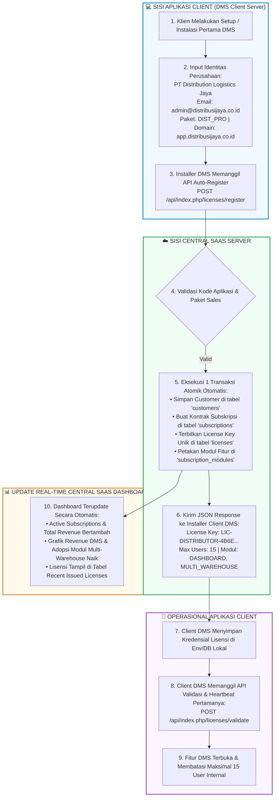
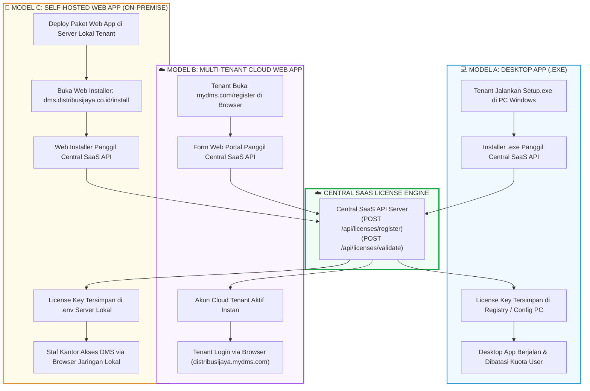

# BUKU PANDUAN PENGGUNAAN
## Central SaaS — License Management Dashboard

---

## 📌 1. Pendahuluan

**Central SaaS License Management Dashboard** adalah platform terpusat untuk mengelola **Katalog Produk (Aplikasi & Modul)**, **Paket Penjualan**, **Data Pelanggan**, **Subskripsi/Kontrak**, serta **Penerbitan & Validasi Lisensi** untuk berbagai aplikasi SaaS (seperti *Apotek System*, *Distributor System*, *Training Management System (TMS)*, *ERP*, dll).

### 💡 Prinsip Utama Arsitektur (Separation of Concerns)
* **Tanggung Jawab Central SaaS**:
  1. Mengelola Katalog Produk (Aplikasi, Modul, & Paket Harga).
  2. Menyediakan API **Auto-Register Customer & Lisensi** secara otomatis.
  3. Menentukan modul fitur apa saja yang **berhak digunakan** oleh pelanggan (`modules`).
  4. Menentukan **batas kuota maksimal pengguna (`max_users`)**.
  5. Memvalidasi status lisensi (aktif, terblokir, kedaluwarsa).
* **Tanggung Jawab Aplikasi Client (Apotek, TMS, Distributor)**:
  1. Memanggil API Auto-Register saat instalasi/pembelian paket oleh customer baru.
  2. Pengelolaan User internal (Admin, Kasir, Apoteker, Sales).
  3. Pengelolaan Role & Permission internal.
  4. *Aplikasi client yang membatasi user mana yang boleh memakai modul tertentu berdasarkan kuota dari Central SaaS.*

---

## 🚀 2. Dua Metode Pendaftaran Customer & Lisensi

1. **Mode 1: Auto-Register (Otomatis / Rekomendasi Utama)**:
   - **Tanpa Input Manual Superadmin**.
   - Saat customer menginstall aplikasi (misal: *Apotek Paket A*), installer aplikasi client otomatis memanggil API `POST /api/licenses/register`.
   - Central SaaS otomatis mendata Customer baru, Subskripsi baru, dan Menerbitkan License Key unik secara gratis dalam 1 transaksi.
2. **Mode 2: Manual Input (Kontrak B2B / Custom)**:
   - Digunakan jika ada penanganan khusus kontrak B2B.
   - Superadmin menambah Customer di menu **Customers**, lalu membuat **Subscription** manual di dashboard.

---

## ⚡ 3. Dokumentasi Integrasi API untuk Aplikasi Client

Aplikasi client (seperti *Apotek*, *TMS*, atau *Distributor*) menggunakan 2 API utama berikut:

### 3.1. API Auto-Register Customer & Lisensi Baru (Instalasi Pertama)
* **URL**: `POST http://localhost:8080/License-Management-Dashboard/api/licenses/register`
* **Headers**: `Content-Type: application/json`
* **JSON Request Body**:
  ```json
  {
    "app_code": "APOTEK",
    "package_code": "APO_BASIC",
    "customer_name": "Apotek Maju Jaya Farmasi",
    "customer_email": "owner@apotekmajujaya.com",
    "customer_phone": "08123456789",
    "instance_key": "INST-APO-MJJ-001",
    "domain": "apotekmajujaya.com"
  }
  ```
* **JSON Response Body (Sukses)**:
  ```json
  {
    "success": true,
    "message": "Customer & License auto-registered successfully!",
    "data": {
      "auto_registered": true,
      "customer_name": "Apotek Maju Jaya Farmasi",
      "application": "Apotek Management System",
      "package": "Apotek Basic",
      "license_key": "LIC-APOTEK-BE597CEBC92282759F0709E8",
      "instance_key": "INST-APO-MJJ-001",
      "activation_key": "ACT-ACT-C136EA8482E55A2F",
      "max_users": 3,
      "modules": [
        "DASHBOARD",
        "INVENTORY",
        "MASTER_OBAT",
        "POS_KASIR"
      ]
    }
  }
  ```

---

### 3.3. Simulasi Alur Lengkap: Instalasi Aplikasi Client DMS hingga Tampil di Dashboard

Berikut adalah alur lengkap end-to-end instalasi aplikasi client **Distributor Management System (DMS)** oleh tenant baru (**PT Distribution Logistics Jaya**) dari awal pengisian form installer hingga data lisensi dan analitiknya muncul secara *real-time* di Central SaaS.

#### 🗺️ Flowchart Alur Integrasi Lintas Sistem



---

#### 📝 Rincian Langkah Simulasi Konkret

##### **Langkah 1: Client DMS Mengirim HTTP Request Auto-Register**
Installer client DMS mengirimkan payload JSON saat proses setup/instalasi pertama:

* **URL Target**: `POST http://localhost:8080/License-Management-Dashboard/api/index.php/licenses/register`
* **Headers**: `Content-Type: application/json`
* **Request Body (JSON)**:
  ```json
  {
    "app_code": "DISTRIBUTOR",
    "package_code": "DIST_PRO",
    "customer_name": "PT Distribution Logistics Jaya",
    "customer_email": "admin@distribusijaya.co.id",
    "customer_phone": "081299001122",
    "instance_key": "INST-DIST-LOG-001",
    "domain": "app.distribusijaya.co.id"
  }
  ```

##### **Langkah 2: Central SaaS Memproses & Mengembalikan Response**
Central SaaS memproses pendaftaran secara otomatis dan merespon dengan status **`201 Created`**:

* **Response Body (JSON)**:
  ```json
  {
    "success": true,
    "message": "Customer & License auto-registered successfully!",
    "data": {
      "auto_registered": true,
      "customer_name": "PT Distribution Logistics Jaya",
      "customer_email": "admin@distribusijaya.co.id",
      "application": "Distributor Management System",
      "package": "Distributor Pro",
      "license_key": "LIC-DISTRIBUTOR-4B6EAC49D7FB4C2651356C15",
      "instance_key": "INST-DIST-LOG-001",
      "activation_key": "ACT-ACT-C17EC848EA028099",
      "max_users": 15,
      "modules": [
        "DASHBOARD",
        "MULTI_WAREHOUSE"
      ]
    }
  }
  ```

##### **Langkah 3: Client DMS Melakukan Validasi pertamanya**
Client DMS memanggil API validasi untuk memverifikasi hak akses fitur:

* **URL Target**: `POST http://localhost:8080/License-Management-Dashboard/api/index.php/licenses/validate`
* **Response Status**: `200 OK` (`"valid": true`, `"max_users": 15`).

##### **Langkah 4: Dampak pada Dashboard Analitik Central SaaS**
Tanpa perlu refresh manual, data baru langsung tercatat di Central SaaS:
1. **Indikator KPI**: *Active Subscriptions* dan *Total Revenue* bertambah otomatis.
2. **Grafik Revenue per Aplikasi**: Porsi omset *Distributor Management System* meningkat secara visual.
3. **Grafik Adopsi Modul Fitur**: Modul `MULTI_WAREHOUSE` bertambah jumlah tenant penggunanya.
4. **Tabel Lisensi Terbaru**: Lisensi `LIC-DISTRIBUTOR-4B6E...` atas nama **PT Distribution Logistics Jaya** tampil di posisi paling atas tabel *Recent Issued Licenses*.

---

### 3.4. Model Arsitektur Deployment Aplikasi Client & Integrasi Lisensi Universal

API Central SaaS (`POST /api/licenses/register` dan `POST /api/licenses/validate`) bersifat **universal & agnostik** terhadap jenis aplikasi client. Baik aplikasi berupa **Desktop App (.exe)**, **Web App Cloud**, maupun **Web App On-Premise (Server Lokal Tenant)**, semuanya dapat terintegrasi dengan mudah.

#### 🌐 3 Model Deployment Utama:

1. **💻 Model A: Desktop Application (.exe / Windows Native / Electron)**
   - **Instalasi**: File installer `setup.exe` dijalankan di PC Windows tenant.
   - **Integrasi Lisensi**: Installer memanggil API `register` saat setup pertama, lalu menyimpan License Key di Registry / Local File PC tenant.

2. **☁️ Model B: Multi-Tenant Cloud Web App (SaaS Terpusat - Hosted by Provider)**
   - **Instalasi**: **Tanpa Instalasi di Sisi Tenant**. Aplikasi di-host di cloud milik SaaS Provider (`app.mydms.com`).
   - **Integrasi Lisensi**: Tenant mendaftar via web portal (`mydms.com/register`). Backend web portal memanggil API `register` ke Central SaaS, dan tenant langsung login via browser.

3. **🏢 Model C: On-Premise / Self-Hosted Web App (Server Lokal Tenant)**
   - **Instalasi**: Web App di-install di server lokal/VPS milik tenant (`dms.distribusijaya.co.id`).
   - **Integrasi Lisensi**: Web Installer Script (`http://dms.distribusijaya.co.id/install`) memanggil API `register` ke Central SaaS dan menyimpan License Key di file `.env` server lokal.

#### 🗺️ Modern Flowchart: Perbandingan 3 Model Deployment WebApp & Desktop



---

## 📊 4. Panduan Dashboard Analitik & Pengambilan Keputusan (Decision Support System)

Dashboard Central SaaS dilengkapi dengan modul visualisasi **Executive & Operational Analytics** (Fase 1 & Fase 2) yang dirancang khusus sebagai instrumen pendukung pengambilan keputusan bisnis, pengembangan produk, dan mitigasi *churn rate* pelanggan.

> 📖 *Dokumentasi lengkap matriks manajerial & rekomendasi strategis dapat dibaca pada file [`REKOMENDASI_DECISION_SUPPORT.md`](file:///c:/xampp/htdocs/License-Management-Dashboard/docs/REKOMENDASI_DECISION_SUPPORT.md).*

### 4.1. Delapan Grafik Utama & Peran Pengambilan Keputusan

#### **Fase 1: Overview Eksekutif & Revenue**
1. **⏳ Radar Jatuh Tempo Lisensi (*License Expiration Radar*)**: Mengelompokkan sisa masa berlaku lisensi (*Expired*, *≤7 Hari Kritis*, *8–30 Hari*, *31–90 Hari*, *>90 Hari*) untuk mencegah *churn*.
2. **💰 Kontribusi Revenue per Aplikasi (*Product Revenue Distribution*)**: Sebaran nilai omset antar katalog produk SaaS (*Apotek*, *Distributor*, *TMS*) untuk penentuan produk *cash cow*.
3. **📈 Tren Pertumbuhan Pendapatan Bulanan (*MRR Trend*)**: Kurva perkembangan akumulasi nilai kontrak per bulan untuk evaluasi *growth trajectory*.
4. **🧩 Tingkat Adopsi Modul Fitur (*Feature Popularity*)**: Peringkat modul fitur paling terlaris untuk evaluasi *bundling* paket.

#### **Fase 2: Analisis Bisnis Lanjutan & Health Ops**
5. **🔄 Distribusi Model Pembayaran (*Billing Cycle*)**: Rasio langganan bulanan (*monthly*) vs tahunan (*annual*) untuk stabilitas *cash flow*.
6. **👥 Skala Kuota Pengguna (*Max Users Capacity Tiering*)**: Distribusi kuota pengguna tenant (Starter 1-3 user, Medium 4-10 user, Enterprise >10 user) untuk strategi *upsell*.
7. **🛡️ Rasio Keberhasilan & Keamanan API Lisensi (*API Health*)**: Perbandingan otorisasi sukses vs gagal untuk deteksi awal pembajakan / error.
8. **📡 Status Aktivitas Instance Tenant (*Instance Heartbeat*)**: Pengelompokan status operasional client (Aktif <24h, Siaga 1-7d, Dorman >7d) untuk intervensi *Customer Success*.

---

### 4.2. Radar Aksi: Penanganan Lisensi Kritis & Kadaluwarsa

Tepat di bawah grafik, sistem menyediakan panel interaktif **🚨 Radar Aksi: Lisensi Jatuh Tempo ≤ 30 Hari & Expired**:
* **Banner Peringatan Dini**: Otomatis muncul di bagian paling atas dashboard jika ada lisensi yang berada pada masa kritis (≤ 7 hari) atau sudah kedaluwarsa.
* **Aksi Cepat Follow-up**:
  * Tombol **"💬 Hubungi WA"**: Membuka tautan WhatsApp Web/App ke nomor telepon penanggung jawab customer dengan satu klik.
  * Tombol **"Perpanjang"**: Mengarahkan admin ke menu *Subscriptions* untuk memperbarui masa berlaku kontrak lisensi pelanggan.

---

## 🔒 5. Arsitektur Keamanan & Anti-Pembajakan (Security Architecture)

Central SaaS dirancang dengan 7 lapis keamanan (*defense-in-depth*) untuk melindungi lisensi dari pembajakan, penyalahgunaan domain, SQL injection, serta serangan DoS.

### 🛡️ 7 Layer Keamanan Utama:

1. **🔑 API Key & Secret Signature Authentication**:
   - Setiap aplikasi client (Apotek, DMS, TMS) memiliki `App-Secret` / API Key khusus.
   - Request tanpa API Key yang sah akan ditolak oleh gateway (`401 Unauthorized`).

2. **🌐 Binding Domain & Instance Key (Anti-Clone / Anti-Piracy)**:
   - Lisensi dikunci secara spesifik ke gabungan `license_key` + `domain` + `instance_key`.
   - Jika kredensial lisensi dicuri dan dipasang di domain lain (misal: `hacker-site.com`), API validasi otomatis mengembalikan `"valid": false, "reason": "domain_mismatch"`.

3. **🔒 Kriptografi License Key & Hashing SHA-256**:
   - String License Key (`LIC-DISTRIBUTOR-4B6E...`) dan Activation Key diproduksi menggunakan Hashing SHA-256 acak yang tidak dapat ditebak (*unpredictable key generation*).

4. **🛡️ Prepared Statements PDO (Proteksi SQL Injection)**:
   - Seluruh query database di backend PHP (`LicenseModel`, `CustomerModel`, `AnalyticsModel`) menggunakan **PDO Parameterized Query**, sehingga 100% aman dari ancaman SQL Injection (SQLi).

5. **🚨 Health Check & Dynamic Anomaly Detection**:
   - Setiap kali terjadi kegagalan validasi (misal domain mismatch atau expired), sistem mencatat log kejadian di `validation_logs`.
   - Lonjakan kegagalan otomatis memicu grafik **Health Check Validasi API** di dashboard untuk memberi peringatan awal percobaan peretasan/pembajakan.

6. **🔒 Enkripsi Transport TLS/HTTPS**:
   - Seluruh komunikasi API antara aplikasi client dan Central SaaS di lingkungan production diwajibkan menggunakan enkripsi HTTPS/TLS 1.3 untuk mencegah sniffing data di jaringan (*Man-in-the-Middle Attack*).

7. **⚡ Anti-Brute Force Rate Limiting**:
   - Pembatasan jumlah request HTTP per IP per menit untuk mencegah serangan percobaan kunci lisensi secara membabi buta (*brute force / dictionary attack*).

---

## ❓ 6. Pertanyaan Umum (FAQ)

1. **Apakah Superadmin harus meng-input customer satu per satu?**
   - **Tidak perlu**. Saat customer menginstall aplikasi client, API `POST /api/licenses/register` akan mendaftarkan customer, membuat subskripsi, dan menerbitkan lisensi secara otomatis. Data customer tersebut langsung muncul di dashboard.
2. **Bagaimana jika lisensi kedaluwarsa (Expired)?**
   - API validasi akan mengembalikan `"valid": false`. Aplikasi client harus membatasi atau mengunci akses fitur berbayar.
3. **Kapan grafik di dashboard diperbarui?**
   - Data grafik diperbarui secara real-time setiap kali halaman dimuat, atau dapat diperbarui manual dengan menekan tombol **"🔄 Segarkan Data"** di pojok kanan atas dashboard.
4. **Apakah aplikasi aman dari duplikasi lisensi di server lain?**
   - **Sangat Aman**. Mekanisme *Domain & Instance Key Binding* akan mendeteksi perbedaan domain dan langsung mengunci aplikasi jika dipindahkan tanpa izin.

---

## 🛒 6. Integrasi Level 8: Commercial Onboarding & Approval API dari Showcase

Central SaaS LMD kini telah terintegrasi penuh dengan portal **Software Showcase** untuk melayani pendaftaran mandiri calon pelanggan (*Self-Service Commercial Onboarding*) sebelum lisensi diaktifkan.

### 6.1. Alur 3 Tahap Level 8
1. **Commercial Phase (Pemesanan & Tagihan):**
   - Calon klien memilih paket di Showcase, mengisi data diri dan subdomain toko, lalu memilih metode bayar (QRIS / Transfer Bank).
   - Showcase mengirim request ke LMD: `POST /api/licenses/order`.
   - LMD otomatis membuat entitas **Customer** baru, **Subscription** dengan status `pending`, dan **License** dengan status `suspended` (menunggu konfirmasi).
2. **Provisioning Phase (Verifikasi & Persetujuan Admin):**
   - Di dashboard Central SaaS LMD tampil panel notifikasi: **"🔔 Persetujuan Pembayaran & Aktivasi Domain Klien"**.
   - Admin mengecek bukti bayar dan menekan tombol **"✓ Approve & Aktifkan"** (`POST /api/licenses/approve_order`).
   - LMD mengubah status Subscription & License menjadi `active`, serta mengaktifkan **Application Instance** (domain instans klien).
3. **Runtime Phase (Polling Real-Time & Akses Instan):**
   - Browser klien di Showcase yang sedang melakukan polling status (`GET /api/licenses/order_status`) otomatis mendeteksi status `is_approved: true`.
   - Layar klien seketika memunculkan tombol **"🚀 Buka Aplikasi Saya Sekarang"** tanpa perlu instalasi file ZIP manual.

---

### 6.2. Spesifikasi Endpoint Baru

#### 1. Buat Pesanan Baru (Showcase ➔ LMD)
* **URL:** `POST /api/licenses/order` (atau `/api/index.php/licenses/order`)
* **Headers:** `Content-Type: application/json`
* **Request Body:**
  ```json
  {
    "app_code": "APOTEK",
    "package_code": "APO_PRO",
    "customer_name": "Toko Kopi Joan",
    "customer_email": "joan@kedaikopi.com",
    "customer_phone": "08123456789",
    "subdomain": "kedaikopijoan",
    "payment_method": "QRIS"
  }
  ```
* **Response Body (201 Created):**
  ```json
  {
    "success": true,
    "message": "Order created successfully, awaiting payment verification.",
    "data": {
      "order_no": "INV-20261022-0011",
      "subscription_no": "SUB-2026-77791",
      "license_key": "LIC-APOTEK-CA2097068CE5...",
      "instance_domain": "kedaikopijoan.pos.local",
      "status": "pending_payment"
    }
  }
  ```

#### 2. Dapatkan Daftar Pesanan Menunggu Approval (Admin Dashboard)
* **URL:** `GET /api/licenses/pending_orders`
* **Response Body (200 OK):**
  Menampilkan daftar pesanan dengan `sub_status: "pending"`.

#### 3. Setujui Pembayaran & Terbitkan Domain (Admin Dashboard)
* **URL:** `POST /api/licenses/approve_order`
* **Headers:** `Content-Type: application/json`
* **Request Body:**
  ```json
  {
    "subscription_no": "SUB-2026-77791"
  }
  ```
* **Response Body (200 OK):**
  ```json
  {
    "success": true,
    "message": "Order approved, license and instance successfully provisioned!",
    "data": {
      "approved": true,
      "status": "active",
      "license_key": "LIC-APOTEK-CA2097068CE5...",
      "client_domain": "kedaikopijoan.pos.local",
      "instance_url": "http://localhost:8080/mini-pos/?tenant=kedaikopijoan.pos.local&lic=LIC-..."
    }
  }
  ```

#### 4. Polling Status Persetujuan (Showcase Client Polling)
* **URL:** `GET /api/licenses/order_status?subscription_no=SUB-2026-77791`
* **Response Body (200 OK):**
  ```json
  {
    "success": true,
    "data": {
      "subscription_no": "SUB-2026-77791",
      "sub_status": "active",
      "is_approved": true,
      "license_key": "LIC-APOTEK-CA2097068CE5...",
      "app_url": "http://localhost:8080/mini-pos/?tenant=kedaikopijoan.pos.local&lic=LIC-..."
    }
  }
  ```


---

## ⏳ 7. Pekerjaan Tertunda / Backlog: Otomatisasi Approval via n8n & Payment Webhook

### 📌 Ringkasan Rencana Peningkatan
Saat ini, pesanan lisensi komersial dari Showcase yang berstatus `pending` diverifikasi dan disetujui secara manual oleh Admin melalui tombol **"✓ Approve & Aktifkan"** pada dashboard Central SaaS LMD.

Di masa mendatang (tahap *production go-live*), proses ini akan diotomatisasi penuh menggunakan **n8n Workflow Automation**:

1. **Trigger:** Webhook uang masuk dari Payment Gateway (Midtrans/Xendit) atau layanan pemantau mutasi rekening bank (Moota/CekMutasi).
2. **Action di n8n:**
   - Memvalidasi payload: status pembayaran `settlement` / `success` dan nominal tagihan.
   - Mengeksekusi API call:
     ```http
     POST http://localhost:8080/License-Management-Dashboard/api/licenses/approve_order
     Content-Type: application/json

     {
       "subscription_no": "{{ $json.order_id }}"
     }
     ```
3. **Notifikasi Otomatis:**
   - n8n mengirim pesan WhatsApp konfirmasi tanda terima pembayaran ke nomor customer yang terdaftar di `customers.phone`.
4.---

## 🖥️ 8. Fitur Application Instances — Monitoring Perangkat Client per Lisensi

### 8.1. Konsep: Pemisahan Tanggung Jawab (Separation of Concerns)

Penting dipahami perbedaan antara apa yang dikelola **Central SaaS LMD** versus **Aplikasi Client** (Apotek, TMS, dll):

| Aspek | Dikelola oleh | Lokasi Data |
|---|---|---|
| **Kuota maksimal user (max_users)** | ✅ Central SaaS LMD | Tabel `subscriptions.max_users` |
| **Jumlah perangkat/workstation aktif** | ✅ Central SaaS LMD | Tabel `application_instances` |
| **Daftar akun staff internal** (Kasir 1, Kasir 2, Apoteker) | ❌ Aplikasi Client | Database lokal Apotek/TMS |
| **Login/session management staff** | ❌ Aplikasi Client | Database lokal Apotek/TMS |

> **Analogi:** Central SaaS = penerbit SIM (menentukan hak & kuota maksimal pengemudi). Apotek App = garasi (mengelola siapa saja nama supir/staff yang terdaftar, tidak boleh melebihi kuota SIM).

---

### 8.2. Schema Database Terkait

**Tabel `subscriptions`** (di database `central_saas`):
```sql
-- Field penting untuk monitoring kuota
max_users INT UNSIGNED NOT NULL DEFAULT 1  -- Kuota maksimal akun staff
status ENUM('pending','active','suspended','expired','cancelled')
```

**Tabel `application_instances`** (di database `central_saas`):
```sql
id              BIGINT UNSIGNED AUTO_INCREMENT PRIMARY KEY
license_id      BIGINT UNSIGNED NOT NULL  -- FK ke tabel licenses
instance_key    VARCHAR(150) UNIQUE NOT NULL
instance_name   VARCHAR(150) NOT NULL
domain          VARCHAR(255)              -- Domain/IP client yang terhubung
environment     ENUM('production','staging','development') DEFAULT 'production'
last_seen_at    DATETIME                  -- Kapan terakhir client melakukan heartbeat
status          ENUM('active','inactive','blocked') DEFAULT 'active'
created_at      DATETIME DEFAULT CURRENT_TIMESTAMP
updated_at      DATETIME DEFAULT CURRENT_TIMESTAMP ON UPDATE CURRENT_TIMESTAMP
```

---

### 8.3. Data Nyata: Budi Santoso (Apotek Management System)

Berdasarkan registrasi mandiri yang dilakukan dari portal Software Showcase:

| Field | Nilai |
|---|---|
| **Customer ID** | 12 |
| **Customer Code** | `CUST-D5C820` |
| **Nama Customer** | Budi Santoso |
| **Email** | budi@apoteksehat.com |
| **Subscription No** | `SUB-2026-73849` |
| **Paket** | Apotek Basic |
| **Kuota User (max_users)** | **3 Users** |
| **License Key** | `LIC-APOTEK-1C2FE18696DC40227E675CDF` |
| **Status License** | ✅ active |
| **Masa Berlaku** | 2026-10-22 s/d 2027-10-22 |

**Instances yang terhubung (2 perangkat):**

| Instance Name | Domain / IP | Environment | Last Seen | Status |
|---|---|---|---|---|
| Budi Santoso Store | `apoteksehat.pos.local` | production | 22 Okt 2026 | 🟢 active |
| Instance (192.168.0.116) | `192.168.0.116` | production | 22 Okt 2026 | 🟢 active |

---

### 8.4. Cara Melihat Application Instances di LMD Dashboard

**Langkah-langkah Operasional Admin:**
1. Buka browser: `http://localhost:8080/License-Management-Dashboard/`
2. Klik menu **🔑 Licenses** di sidebar kiri.
3. Pada tabel **License Credentials**, perhatikan dua kolom baru:
   - **Kuota User**: Menampilkan badge kapasitas akun staff (misal: `👥 3 Users`).
   - **Instances Aktif**: Menampilkan badge jumlah perangkat terkoneksi (misal: `🖥️ 2 Aktif`).
4. Klik tombol **🔍 Lihat** pada baris pelanggan yang ingin diperiksa (misal baris Budi Santoso).
5. Modal popup **Application Instances** akan tampil menyajikan:
   - Header ringkasan Lisensi, Paket, Kuota User, dan Status.
   - Kartu detail setiap instance (Nama, Domain/IP, Environment, Terdaftar, Last Seen, dan Status 🟢 Aktif).

---

### 8.5. API Endpoint Baru: Get Instances per License

Endpoint pendukung untuk query detail instance lisensi:

* **URL:** `GET /api/licenses/{license_id}/instances`
* **Contoh Request:** `GET /api/index.php/licenses/12/instances`
* **Response Body (200 OK):**
  ```json
  {
    "success": true,
    "message": "Instances fetched successfully.",
    "data": {
      "license_key": "LIC-APOTEK-1C2FE18696DC40227E675CDF",
      "customer_name": "Budi Santoso",
      "max_users": 3,
      "status": "active",
      "instances": [
        {
          "id": 16,
          "instance_name": "Budi Santoso Store",
          "domain": "apoteksehat.pos.local",
          "environment": "production",
          "status": "active",
          "last_seen_at": "2026-10-22 23:38:29",
          "created_at": "2026-10-22 23:37:39"
        },
        {
          "id": 17,
          "instance_name": "Instance (192.168.0.116)",
          "domain": "192.168.0.116",
          "environment": "production",
          "status": "active",
          "last_seen_at": "2026-10-22 23:38:59",
          "created_at": "2026-10-22 23:38:59"
        }
      ]
    }
  }
  ```

---

### 8.6. Jejak Digital / Audit Trail

Setiap aksi persetujuan order, penerbitan lisensi, perubahan status, dan koneksi instance terekam secara otomatis di database. Riwayat audit dapat dipantau langsung pada menu **📋 License Audit Logs** di dashboard LMD.

---

### 8.7. File yang Terlibat dalam Implementasi Ini

| File | Peran & Modifikasi |
|---|---|
| `api/index.php` | Menambahkan routing `GET /licenses/{id}/instances` |
| `api/controllers/LicenseController.php` | Method `getInstances($licenseId)` untuk mengambil daftar instans per lisensi |
| `api/models/LicenseModel.php` | Method `getById()` yang mengembalikan detail lisensi beserta relasi instans |
| `index.html` | Penambahan kolom **Kuota User**, **Instances Aktif**, tombol **🔍 Lihat**, serta template **Modal Application Instances** |
| `assets/js/app.js` | State modal (`showInstanceModal`, `selectedLicense`, `selectedInstances`) dan method `viewInstances(lic)` |

---

## 🛡️ 9. Proteksi Akses Klien: Validasi Gerbang (Gatekeeper) & Pencegahan Akses Langsung

### 9.1. Latar Belakang Masalah
Sebelum fitur ini diterapkan, aplikasi client (seperti `mini-pos`) dapat diakses langsung oleh siapa saja hanya dengan mengetik URL di browser (`http://localhost:8080/mini-pos/`). Ini berpotensi:
1. Membuka form aktivasi lisensi internal secara bebas tanpa melalui pembayaran.
2. Membypass portal komersial resmi (**Software Showcase**).

### 9.2. Mekanisme Proteksi Gerbang Berlapis (Multi-Tier Gatekeeper)

Sistem proteksi diterapkan pada 2 level:

```
[Pengguna mengetik: domain/mini-pos/]
                │
                ▼
  ┌───────────────────────────┐
  │ 1. Server Gatekeeper      │
  │    (index.php)            │
  └─────────────┬─────────────┘
                │
        Ada param lic & tenant?
        ├── TIDAK ──► 🚨 HTTP 302 REDIRECT ke /software-showcase/?notice=unauthorized_direct_access
        │
        └── YA ─────► Cek Database central_saas:
                      Lisensi terdaftar & status 'active'?
                      ├── TIDAK ──► 🚨 REDIRECT ke /software-showcase/?notice=invalid_license
                      └── YA ─────► Loloskan & Render Mini POS Cashier
                                          │
                                          ▼
                               ┌───────────────────────────┐
                               │ 2. Client Gatekeeper      │
                               │    (app.js)               │
                               └─────────────┬─────────────┘
                                             │
                                             ▼
                               Kirim Heartbeat & Validasi Telemetri ke LMD API
                               (POST /api/licenses/validate)
```

### 9.3. Penanganan Skenario Akses

| Skenario | Tindakan Sistem | Hasil Akhir |
|---|---|---|
| **Akses Langsung Tanpa Parameter**<br>`http://localhost:8080/mini-pos/` | Ditolak oleh Server & Client Gatekeeper | Langsung dialihkan ke **Software Showcase** dengan toast: `🔒 Akses Langsung Ditolak: Aplikasi klien tidak dapat dibuka langsung. Silakan pilih paket dan lakukan instalasi melalui portal ini.` |
| **Akses dengan Lisensi Palsu / Expired**<br>`?tenant=fake&lic=LIC-FAKE` | Divalidasi ke DB LMD & API LMD | Ditolak dengan pesan: `❌ Lisensi Tidak Terdaftar atau Belum Disetujui.` Dialihkan ke Showcase. |
| **Akses Resmi dari Showcase**<br>`?tenant=apoteksehat.pos.local&lic=LIC-APOTEK-...` | Terverifikasi `status = active` di Central SaaS LMD | **Mini POS terbuka penuh**, menampilkan Nama Toko Pelanggan, Kuota User, dan status `🟢 Lisensi Aktif`. |

### 9.4. File yang Terlibat

| File | Fungsi |
|---|---|
| `c:\xampp\htdocs\mini-pos\index.php` | Server Gatekeeper: Verifikasi database dan redirect otomatis jika tidak berlisensi. |
| `c:\xampp\htdocs\mini-pos\index.html` | Client Fallback Guard: Script otomatis mengalihkan jika file statis dibuka langsung. |
| `c:\xampp\htdocs\mini-pos\app.js` | Runtime Engine: Menghapus form pendaftaran manual internal, memvalidasi telemetri ke API LMD. |
| `c:\xampp\htdocs\software-showcase\assets\js\app.js` | Notice Handler: Menampilkan toast pemberitahuan ramah saat pengguna ter-redirect dari mini-pos. |


