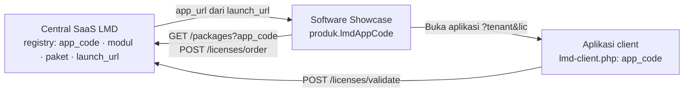

# Standar Integrasi Central SaaS LMD — v1

> Kontrak wajib antara **Central SaaS LMD**, **Software Showcase**, dan setiap **aplikasi client**.
> Berlaku sejak 2026-10-30. Implementasi acuan: Mini POS Express (`joan-hidayat/sample-mini-pos`).
> Perubahan pada kontrak ini wajib dicatat di [`LOG_EVALUASI.md`](LOG_EVALUASI.md) dan menaikkan nomor versi.

Status: ✅ berlaku · 📋 rencana (belum wajib)

---

## 1. Prinsip

1. **Satu kode aplikasi (`app_code`) di tiga tempat.** Kode yang sama dipakai di LMD (registry), Showcase (`lmdAppCode`), dan client (`lmd-client.php`). Kode ini adalah identitas aplikasi.
2. **LMD adalah sumber tunggal** untuk paket, harga, kuota, modul, dan status lisensi. Showcase dan client tidak menulis angka-angka itu sendiri.
3. **LMD tidak membaca apa pun dari client.** Client yang memanggil API LMD; LMD mengenali aplikasi dari license key yang dikirim.
4. **User, role, dan login adalah urusan client.** LMD hanya memberi kuota (`max_users`) dan daftar modul.



---

## 2. Kewajiban di LMD (registry aplikasi) ✅

Setiap aplikasi terdaftar di menu **Applications & Modules** dengan:

| Field | Wajib | Keterangan |
|---|---|---|
| `code` | ✅ | Huruf besar, unik, tidak pernah diganti setelah ada lisensi. Contoh `MINIPOS`. |
| `name`, `description` | ✅ | Ditampilkan di dashboard dan respons API. |
| `launch_url` | Hanya aplikasi hosted | Template URL yang dibuka customer setelah pembayaran disetujui. Placeholder: `{tenant}` (domain instance) dan `{license_key}`. Awali dengan `/` untuk host yang sama dengan LMD. **Kosongkan** untuk aplikasi on-premise: customer menerima license key untuk dimasukkan saat instalasi. |
| Modul | ✅ minimal 1 | Kode modul unik per aplikasi (`KASIR`, `LAPORAN`, …). |
| Paket | ✅ minimal 1 publik | `code`, harga, `billing_cycle`, `max_users`, `max_instances`, modul, `is_public`. |

Aplikasi bawaan didaftarkan lewat `database/migrate.php` (fungsi `registerApplication`) agar bisa dipasang ulang di setiap server tanpa input manual.

---

## 3. Kewajiban di Software Showcase ✅

| Aturan | Keterangan |
|---|---|
| Setiap produk yang bisa dipesan punya `lmdAppCode` | Diisi di Admin Showcase → *Kode Aplikasi di LMD*, tersimpan di `data/products.js`. |
| Produk tanpa `lmdAppCode` tidak bisa dipesan | Tombol tampil **Segera hadir** (nonaktif). |
| Paket tidak ditulis di Showcase | Kartu paket dimuat dari `GET /packages?app_code={lmdAppCode}`. |
| Order memakai `app_code` produk | `POST /licenses/order` dengan `app_code = lmdAppCode`. |
| URL aplikasi dari LMD | Setelah approve, tombol **Buka Aplikasi** memakai `app_url` dari `order_status`. Jika `app_url` kosong (on-premise), tampilkan license key + petunjuk instalasi. |

---

## 4. Kewajiban di aplikasi client

### 4.1. File identitas `lmd-client.php` ✅

Di root aplikasi, dibaca oleh kode integrasi:

```php
<?php
return [
    'app_code'            => 'MINIPOS',   // = applications.code di LMD
    'lmd_api_url'         => null,        // null = host yang sama; production: https://license.domain.com/api/index.php
    'instance_key_prefix' => 'INST-STORE-',
    // 📋 Production (T-04 / T-22):
    // 'app_id'     => '...',
    // 'app_secret' => getenv('LMD_APP_SECRET'),
];
```

Nilai khusus server ditaruh di `lmd-client.local.php` (tidak di-commit).

### 4.2. Perilaku wajib ✅

| # | Kewajiban | Acuan di Mini POS |
|---|---|---|
| 1 | Memanggil `POST /licenses/validate` **dari server** (bukan browser) dengan `license_key`, `instance_key` (`prefix` + 8 karakter terakhir license key), dan `domain`. | `lib/LicenseGate.php::validateRemote` |
| 2 | **Menolak** respons valid yang `app_code`-nya bukan milik aplikasi ini (alasan lokal `app_mismatch`). | `LicenseGate::validateRemote` |
| 3 | Menyimpan license key setelah aktivasi (DB / `.env` / registry) dan **tidak** mengandalkan URL atau `localStorage`. | tabel `mini_pos.tenants` |
| 4 | Menerima link aktivasi `?tenant={domain}&lic={license_key}` (aplikasi hosted), lalu menghapus `lic` dari URL. | `LicenseGate::enter` |
| 5 | Menerapkan `modules` (fitur) dan `max_users` (jumlah akun aktif). | `UserRepository` |
| 6 | Menangani setiap `reason` penolakan dengan pesan yang jelas (tabel 5). | `LicenseGate::deny` |
| 7 | Cache hasil validasi (≤ 5 menit) dan masa tenggang offline terbatas (≤ 24 jam). | `config.php` |
| 8 | Mengelola user, role, dan login sendiri. Akun admin pertama dibuat dengan email pemesan (`licensee.email`). | `setup.php` |

---

## 5. Kontrak API

Base URL: `{lmd}/api/index.php` (atau `{lmd}/api` bila `api/.htaccess` aktif).

| Endpoint | Pemanggil | Inti |
|---|---|---|
| `GET /packages?app_code=` | Showcase | Paket publik + modul |
| `POST /licenses/order` | Showcase | Pesanan `pending` |
| `GET /licenses/order_status?subscription_no=` | Showcase | `is_approved`, `app_code`, `license_key`, `app_url` (null = on-premise) |
| `POST /licenses/approve_order` · `reject_order` | Admin / n8n | Aktivasi / penolakan |
| `POST /licenses/register` | Installer client (on-premise) | Customer + lisensi langsung aktif |
| `POST /licenses/validate` | Client | Lihat di bawah |

**Respons `validate` sukses:** `valid`, `license_key`, `application`, `app_code`, `expires_at`, `max_users`, `max_instances`, `modules[]`, `licensee {name, email}`, `instance_name`.

**Alasan penolakan (`reason`):**

| `reason` | Sumber | Arti | Tindakan client |
|---|---|---|---|
| *(tanpa reason)* | LMD | Key tidak ada / suspended / expired | Arahkan ke halaman berlangganan |
| `instance_key_conflict` | LMD | Instance key milik lisensi lain | Tampilkan pesan, hubungi penyedia |
| `instance_blocked` | LMD | Instalasi diblokir admin | Tampilkan pesan |
| `domain_mismatch` | LMD | Domain berbeda dari domain terkunci | Tampilkan pesan |
| `instance_limit_reached` | LMD | Kuota lokasi penuh | Tampilkan pesan + saran upgrade |
| `app_mismatch` | Client | License key milik aplikasi lain | Tampilkan pesan + link berlangganan |

---

## 6. Checklist mendaftarkan aplikasi baru

- [ ] **LMD:** aplikasi (`code`, `launch_url` bila hosted), modul, minimal satu paket publik. Untuk aplikasi bawaan, tambahkan `registerApplication(...)` di `database/migrate.php`.
- [ ] **Client:** `lmd-client.php` dengan `app_code` yang sama; kode validasi memenuhi 4.2 (salin pola `LicenseGate.php`).
- [ ] **Client hosted:** menerima `?tenant&lic` sesuai `launch_url`. **On-premise:** wizard instalasi memanggil `POST /licenses/register` atau meminta license key.
- [ ] **Showcase:** produk diberi `lmdAppCode` di Admin Showcase, lalu ekspor `products.js`.
- [ ] **Uji:** pesan dari Showcase → approve → aplikasi terbuka / license key tampil; license key aplikasi lain ditolak (`app_mismatch`); domain lain ditolak (`domain_mismatch`).
- [ ] **Docs:** catat di `LOG_EVALUASI.md`, perbarui `EKOSISTEM_CARA_KERJA.md` bila alur berubah.

---

## 7. Status penerapan

| Aplikasi | `app_code` | Tipe | LMD | Showcase | Client |
|---|---|---|---|---|---|
| Mini POS Express | `MINIPOS` | Hosted (`/mini-pos/`) | ✅ | ✅ | ✅ |
| Apotek Smart POS | `APOTEK` | On-premise (tanpa `launch_url`) | ✅ | ✅ | 📋 client belum ada di repo |
| Distributor (DMS), TMS | `DISTRIBUTOR`, `TMS` | — | ✅ | 📋 belum ada produk | 📋 |
| Produk Showcase lain | — | — | 📋 | Segera hadir | 📋 |
